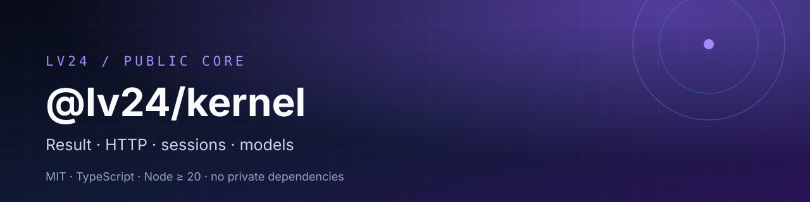

# @lv24/kernel

[](https://www.npmjs.com/package/@lv24/kernel)
[](https://www.npmjs.com/package/@lv24/kernel)
[](https://github.com/LevapVeeskela/lv24-kernel/actions/workflows/ci.yml)
[](https://github.com/LevapVeeskela/lv24-kernel/pkgs/npm/kernel)
[](LICENSE)
[](package.json)
[](package.json)

> **Small, typed foundation for Instagram automation.** Result types, an undici
> HTTP client, a request pipeline with retries and rate-limit interceptors,
> session types, and the official Instagram feed models — with no private
> dependencies.

> **Кратко по-русски.** Публичное MIT-ядро для автоматизации Instagram:
> `Result`, HTTP-клиент на undici, пайплайн с ретраями и rate-limit, типы
> сессии и модели официального API. Node.js ≥ 20, ESM, без приватных
> зависимостей и без сетевых побочек при импорте.

| 🚀 Start | 🧠 Use | 🛠 Build |
| --- | --- | --- |
| [Install](#install) · [Quick start](#quick-start) | [API surface](#api-surface) · [Examples](#examples) | [Design rules](#design-rules) · [Security](#security) · [Contributing](#contributing) |

## Why @lv24/kernel

- **One transport, typed end to end.** `UndiciHttpClient` + `RequestPipeline`
  return `IResult<HttpResponse>` instead of throwing at every call site.
- **Errors are data.** `ResponseType` covers Instagram's real responses
  (login required, challenge, rate limit, action blocked, checkpoint, 2FA).
- **No hidden state.** No global fetch monkey-patching, no credentials, no
  network requests on import. You pass the client and the session.
- **Small surface.** A curated barrel, `sideEffects: false`, ESM only.
- **Reusable outside Instagram.** The result, HTTP and interceptor layers are
  generic; the models and session types are Instagram-shaped.

## Install

```sh
npm install @lv24/kernel
```

Requires Node.js **>= 20**. The package is ESM (`"type": "module"`).

### GitHub Packages mirror

The canonical package is `@lv24/kernel` on npm. A mirror is also published to
GitHub Packages under the repository owner's scope:

```ini
# .npmrc
@levapveeskela:registry=https://npm.pkg.github.com
//npm.pkg.github.com/:_authToken=${GITHUB_TOKEN}
```

```sh
npm install @levapveeskela/kernel
```

GitHub Packages requires a token with `read:packages`, even for public
packages. Prefer npm unless you specifically need the GitHub mirror.

## Quick start

### Result

```ts
import { Result, ResponseType } from '@lv24/kernel';

const ok = Result.success({ id: '1789' });
const failed = Result.fail('rate limited', ResponseType.RequestsLimit);

if (!failed.succeeded) {
  console.log(failed.info.responseType); // "RequestsLimit"
  console.log(failed.info.message);      // "rate limited"
}
```

### HTTP pipeline

```ts
import { RequestPipeline, UndiciHttpClient } from '@lv24/kernel';

const http = new UndiciHttpClient({
  userAgent: 'my-app/1.0',
  defaultTimeout: 30_000,
});

const pipeline = new RequestPipeline({
  httpClient: http,
  baseUrl: 'https://graph.instagram.com',
  maxRetries: 3,
});

const res = await pipeline.execute({
  url: '/v18.0/me',
  method: 'GET',
  headers: { authorization: `Bearer ${process.env.IG_TOKEN}` },
});

if (res.succeeded) {
  console.log(res.value.statusCode, res.value.body);
} else {
  console.log(res.info.responseType, res.info.message);
}
```

### Session and models

```ts
import { MediaExtractor, createMinimalSessionState } from '@lv24/kernel';

const session = createMinimalSessionState('user-1', process.env.IG_TOKEN);
const media = MediaExtractor.extract(rawGraphResponse);
```

## API surface

| Area | Exports |
| --- | --- |
| Result | `IResult<T>`, `Result`, `ResponseType`, `ResultInfo` |
| Errors | `InstaAgentError`, `AuthError`, `TwoFactorRequiredError`, `ChallengeRequiredError`, `RateLimitedError`, `ActionBlockedError`, `InvalidSessionError`, `NetworkError`, `createInstaError` |
| HTTP | `IHttpClient`, `HttpRequestOptions`, `HttpResponse`, `UndiciHttpClient`, `RequestPipeline`, interceptor types, `isRetryError`, `createRetryError` |
| Interceptors | `ErrorInterceptor`, `RateLimitInterceptor`, `RetryInterceptor` |
| Session | `SessionState`, `DeviceInfo`, `SessionCookies`, `AuthTokens`, `DeviceUuids`, `LoggedInUser`, `ISessionHandler`, `isAuthenticatedSession`, `hasGraphApiToken`, `createMinimalSessionState` |
| Models | `UserSchema`, `MediaSchema`, `ImageVersionSchema`, `VideoVersionSchema`, `CandidateSchema`, `ImageVersions2Schema`, account/media/story/reels insight schemas |
| Extractor | `MediaExtractor` |
| Constants | `DEFAULT_LOCALE`, `IG_APP_ID`, `IG_CAPABILITIES`, `APP_VERSION`, `APP_VERSION_CODE` |

## Examples

### Retry an idempotent request

```ts
import { RequestPipeline, RetryInterceptor, UndiciHttpClient } from '@lv24/kernel';

const pipeline = new RequestPipeline({
  httpClient: new UndiciHttpClient(),
  responseInterceptors: [new RetryInterceptor({ maxAttempts: 3, minDelay: 1_000, maxDelay: 10_000 })],
});

const res = await pipeline.execute({ url: 'https://example.com/health', method: 'GET' });
```

### Rate-limit aware calls

```ts
import { RateLimitInterceptor, RequestPipeline, UndiciHttpClient } from '@lv24/kernel';

const pipeline = new RequestPipeline({
  httpClient: new UndiciHttpClient(),
  responseInterceptors: [new RateLimitInterceptor({ baseDelay: 60_000, maxDelay: 300_000 })],
});
```

## Design rules

- **No private imports.** This package must not import `@instaagent/*`.
- **Exact versions.** Dependencies are pinned (`undici`, `zod`, `json-bigint`);
  no `^` or `~`.
- **No side effects.** Importing a module never performs I/O.
- **Curated surface.** New exports are reviewed; deep imports are not part of
  the API.
- **Node-only.** No browser globals in the kernel.

## Security

The kernel is transport and types only. It does not store credentials and does
not log request bodies or headers. When you build on it:

- keep access tokens and session cookies out of logs and error messages;
- treat response bodies as untrusted input;
- respect Instagram rate limits and send requests at a human pace;
- never commit `.env` files or session exports.

See [SECURITY.md](SECURITY.md) for private vulnerability reporting.

## Contributing

Issues and pull requests are welcome. Run `npm ci`, `npm run lint`,
`npm run build` and `npm test` before opening a PR. See
[CONTRIBUTING.md](CONTRIBUTING.md).

## License

MIT © 2026 LevapVeeskela. See [LICENSE](LICENSE).
